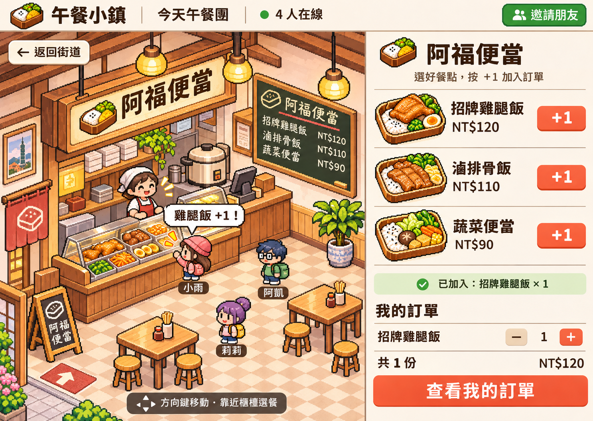
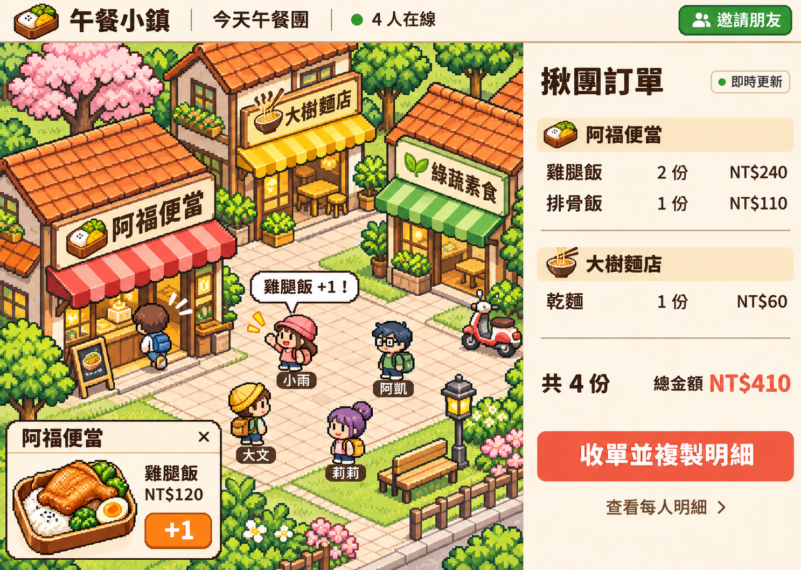

# 午餐小鎮開發規格與團隊發想基準

版本 0.1　更新 2026 年 11 月 5 日　統整 2026 年 11 月 6 日

## 1 本次要做的作品

我們要讓一群人透過同一個網址，進入點陣風格的小街區，操控自己的角色走到店家並進門，查看餐點點陣圖、名稱與價格，按 ＋1 加入自己的訂餐清單。揪團者最後依店家、餐點及個人彙整數量與金額，再向店家訂購。

**展示的核心畫面是兩位使用者同時參與：一人在店內按 ＋1，另一台裝置上的團購統計立即更新。** 遊戲讓挑午餐的過程有參與感，訂餐資料則要正確且能帶走。

本文件讓組員今晚可以各自探索實作與延續發想，明天再決定整合方案。暫名「午餐小鎮」；正式名稱與技術選型保留討論。

### 已定案與可調整部分

| 類別 | 內容 |
| --- | --- |
| 已定案 | 邀請網址、多人參與、點陣角色移動、進店、點陣餐點圖與價格、個人 ＋1、揪團者統計 |
| 已確認的視覺方向 | 暖色點陣便當店內、可見角色與櫃檯、右側清楚列出餐點及個人訂單 |
| 本版建議基準 | 暱稱加入、可減量與取消、收單鎖定、訂單持久化、文字明細匯出 |
| 明天統整 | 街區視角、正式名稱、框架、素材流程、手機優先程度、擴充功能、整合分工 |

## 2 畫面參考

### 店內方向



圖中左側是角色、櫃檯、店員與入口；右側是點陣餐點、價格、＋1、個人份數及金額。此圖用於對齊風格與操作，不把圖片中的文字當成正式資料來源。遊戲中的店名、菜名、價格與按鈕要以可更新的文字介面呈現。

### 街區參考



街區示意圖提供氛圍與多人同場的參考。斜角或俯視呈現尚待明天統整；今晚可先用固定背景與角色疊圖，驗證走到門口和切換場景。

## 3 使用者與完整流程

**揪團者**能開團、邀請、訂自己的餐、查看所有人的明細與店家彙總，最後收單並複製訂購內容。**參與者**能加入、逛店、修改自己的餐點及查看自己的金額。揪團者也有一份自己的訂單。

1. 揪團者輸入團名與暱稱，開團後取得 `/r/{roomId}` 邀請網址。
2. 參與者開啟網址，輸入暱稱及選擇角色後進入街區。第一版可自動分配角色。
3. 角色走到店門附近，看到「按 E 進店」提示；按 E 或點擊進店按鈕切換到店內。
4. 店內右側顯示該店餐點。按 ＋1 加入自己的訂單，得到成功回饋，個人份數與金額更新。
5. 可繼續逛其他店；返回街區、換店與重新整理都保留已成功送出的訂單。
6. 揪團者開啟統計，查看店家彙總與每人明細，按「收單」。
7. 收單成功後大家看到已收單狀態，停止修改；揪團者複製訂購文字，再自行聯絡店家。

MVP 允許同一人跨店訂餐，彙總依店家分組。系統第一版完成「收集與彙整」，訂購行為由人執行。

## 4 最小可行版本

| 優先級 | 範圍 | 完成條件 |
| --- | --- | --- |
| P0 | 開團與邀請 | 可建立房間，另一個獨立瀏覽器使用網址加入 |
| P0 | 街區與移動 | 一張小地圖，至少兩家可進入的店，角色能到門口並進店 |
| P0 | 店內點餐 | 每家至少三個餐點，有點陣圖、名稱、整數新台幣價格與 ＋1 |
| P0 | 個人清單 | 能加、減、取消並顯示份數與金額；刷新後可恢復 |
| P0 | 多人訂單同步 | 兩個獨立使用者點餐，揪團者取得正確即時彙總 |
| P0 | 收單與輸出 | 揪團者可收單，收單後拒絕修改，能複製按店家分組的明細 |
| P1 | 同場角色 | 看見同場其他參與者的位置、暱稱及進出店 |
| P1 | 操作回饋 | 點餐成功泡泡、進店過場、離線與重連提示 |
| P2 | 延伸探索 | 過敏或飲食標籤、店家資料匯入、表情互動、手機移動操作 |

初始資料建議三家店、各三個餐點，交付的範例資料已符合此數量。若時間吃緊，正式展示可縮到兩家店與兩個角色，仍保留完整的進店、點餐與收單流程。

第一版範圍不含付款、配送、店家接單系統、帳號註冊、庫存扣減、優惠與改價、角色裝備、聊天與複雜任務。新點子請保留在回報模板，明天再評估。

## 5 各畫面要能做的事

### 開團與加入

開團頁需要團名、揪團者暱稱與建立按鈕。加入頁顯示團名、暱稱與加入按鈕；無效網址顯示找不到房間，已收單房間只允許既有成員查看。暱稱建議限制 1 至 12 個字，重名以顯示後綴區分；資料識別始終使用 `memberId`。

### 街區

上方保留團名、連線狀態及邀請連結。場景顯示店名、門口互動範圍與自己的角色；有餘裕再顯示其他角色。方向鍵或 WASD 移動，門口提供 E 與可點擊的進店按鈕。文字輸入框取得焦點時，不攔截方向鍵。

### 店內

沿用已確認的暖色點陣方向。左側店內場景與返回街道按鈕，右側餐點列與個人清單。每列包含圖片、名稱、價格及 ＋1。成功後顯示「已加入 雞腿飯 × 1」；失敗時維持原數量並提供重試。待確認的操作顯示處理中，不能先把未確認數量當成已訂成功。

### 我的訂單

依店家顯示餐點、單價、數量及小計；數量降為零即移除。空清單顯示「還沒選餐，進店看看吧」。顯示全部餐點的份數和總金額，不因換店而只計算目前店家。

### 揪團統計與收單

依店家列出每種餐點的總份數和小計，也能展開個人明細。收單按鈕先顯示一次確認，說明將停止大家修改。後端確認成功後顯示最終總額與可複製文字。普通參與者不能收單，也不能修改他人的餐點。

### 手機與可用性

今晚以桌機完整展示為優先。手機至少能看菜單、用按鈕進店與修改訂單；若角色操作尚未完成，可提供「前往店家」按鈕作為替代入口。菜名與價格使用 HTML 文字，讓按鈕能以鍵盤操作，圖片有餐點名稱替代文字，點餐結果以文字同步回饋。

## 6 場景和素材實作基準

建議先用固定背景、角色疊圖與門口互動區完成體驗。碰撞只處理地圖邊界和主要障礙，角色彼此可穿越，減少卡住的機會。進店後切到對應的店內場景；返回街區時出生在該店門外，不再立即觸發進店。

每個場景使用自己的邏輯座標，`x`、`y` 均為 0 到 1。`sceneId` 為 `street` 或 `shop:{storeId}`。斜角畫面可使用平面走道座標再投影，無須先開發完整等角引擎。進出場景後停止上一場景的移動輸入。

建議角色來源尺寸約 32 × 48 或 48 × 64 像素，餐點 96 × 96，背景以實際可用視窗規劃。渲染關閉平滑縮放，優先整數倍放大；文字維持清晰。素材尺寸屬探索起點，可在明天帶回實測結果後統一。

示意圖可以作風格參考，不能直接整張當互動介面。背景圖、角色、餐點圖、碰撞區與按鈕需分離。所有點陣食物素材都要和資料中的 `imageAssetKey` 對應；缺圖時先用同尺寸預設餐點圖，不阻擋流程。

## 7 技術方案建議

以下是可先探索的輕量方案，明天依團隊熟悉度決定。介面契約不綁定特定前端框架。

| 層級 | 建議基準 | 負責範圍 |
| --- | --- | --- |
| 網頁介面 | TypeScript 與 Vite，搭配熟悉的 UI 框架 | 加入、菜單、個人清單、統計與狀態回饋 |
| 遊戲呈現 | Canvas 2D 或團隊熟悉的 2D 工具 | 背景、角色、互動範圍、場景切換 |
| 應用伺服器 | 單一 Node.js 服務 | 身分、房間、點餐交易、收單、匯出 |
| 即時傳輸 | Socket.IO | 房間更新、在線狀態與角色位置 |
| 持久資料 | SQLite 加持久磁碟 | 房間、成員、訂單、請求去重 |

Vite 提供 TypeScript 專案模板與建置流程，見 [Vite 官方指南](https://vite.dev/guide/)。Canvas 適合將背景和動態角色分層，見 [MDN Canvas 最佳化指南](https://developer.mozilla.org/en-US/docs/Web/API/Canvas_API/Tutorial/Optimizing_canvas)。Socket.IO 提供雙向事件與重連能力，但前後端必須使用相容的 Socket.IO 客戶端及伺服器，見 [Socket.IO 官方說明](https://socket.io/docs/v4/)。

角色位置可存在記憶體，重新整理回到出生點即可；已確認訂單必須寫入資料庫。SQLite 的交易與同時寫入限制見 [SQLite 官方交易說明](https://www.sqlite.org/lang_transaction.html)。點餐和收單使用同一套交易序列；遇到忙碌可短暫重試或回傳重試錯誤，不能把未提交操作報成成功。

部署基準是同一個網址供應網頁、API 與即時連線，伺服器與資料庫使用單一實例及持久儲存。部署平台需支援長連線；本文件不指定平台或建立付費服務。若改用託管資料庫與即時服務，仍需滿足本文件的身分、交易、鎖單與重連規則。

## 8 資料模型

完整欄位型別見 `contracts.ts`，菜單範例見 `menu.sample.json`。金額使用整數新台幣，`currency` 固定 `TWD`；不使用浮點運算或客戶端傳入的價格計算帳單。

| 實體 | 核心欄位 | 必要規則 |
| --- | --- | --- |
| Catalog | `catalogVersion`, `stores`, `meals` | 開團綁定一版菜單，該團進行中不改價 |
| Store | `id`, `name`, `sceneId`, `door`, `interiorAssetKey` | `id` 永久識別，門口位於街區座標 |
| Meal | `id`, `storeId`, `name`, `priceTwd`, `imageAssetKey`, `available` | 以 `storeId` 歸屬一家店，停用餐點不可新增 |
| Room | `id`, `title`, `status`, `catalogVersion`, `revision` | `open` 只能轉為 `closed`，MVP 不重新開單 |
| Member | `id`, `roomId`, `nickname`, `avatarId`, `role` | `owner` 或 `participant`，身分由伺服器判定 |
| OrderItem | `roomId`, `memberId`, `mealId`, `quantity`, `unitPriceTwd` | 三欄複合唯一，數量為正整數，零則刪除 |
| ProcessedRequest | `roomId`, `memberId`, `requestId`, `payloadDigest`, `result` | 同請求重送只執行一次，同 ID 不同內容回錯 |
| Presence | `memberId`, `sceneId`, `x`, `y`, `direction`, `seq` | 暫存即時狀態，斷線不刪除訂單 |

同一人同餐點的小計為 `quantity × unitPriceTwd`。店家彙總先以 `mealId` 加總數量再計小計；全團金額等於所有有效訂單項目的小計總和。個人訂單不可由彙總結果反推。

## 9 身分與共用契約

邀請網址只包含房間識別，不包含揪團者權限。加入後由伺服器建立匿名工作階段；同一瀏覽器工作階段重新整理時恢復原成員，不再建立第二份訂單。建議同來源 HttpOnly Cookie，正式 HTTPS 設定 Secure 與適當 SameSite，HTTP 開發環境另行設定。

伺服器由工作階段取得 `memberId` 與角色；修改訂單的請求不接受客戶端指定他人的 `memberId`。同一工作階段在同團開兩個分頁仍是同一個人。驗收兩位使用者時，請使用兩個瀏覽器設定檔、一般與無痕視窗，或兩台裝置。

### 建議 HTTP 介面

以下是本版提議的整合邊界，尚未提供實作；大家可先用相同資料形狀建立 mock adapter。

| 方法與路徑 | 輸入 | 輸出或用途 |
| --- | --- | --- |
| `POST /api/rooms` | `title`, `nickname`, `requestId` | 建立含 owner 成員的房間，回 `invitePath` 與 `snapshot`；同工作階段重試同請求不重複開團 |
| `POST /api/rooms/:id/join` | `nickname`, `avatarId` | 加入或恢復當前成員，回完整 `snapshot` |
| `GET /api/rooms/:id/snapshot` | 工作階段 | 回房間狀態、菜單、本人清單、店家彙總及 `revision` |
| `POST /api/rooms/:id/order-delta` | `mealId`, `delta`, `requestId` | 對本人餐點做 `+1` 或 `-1`，回 `OrderAck` |
| `POST /api/rooms/:id/close` | `requestId` | owner 收單，回已鎖定 `snapshot`；已收單重試回目前結果 |
| `GET /api/rooms/:id/summary` | owner 工作階段 | 回店家彙總、個人明細、總份數和總金額 |
| `GET /api/rooms/:id/export` | owner 工作階段 | 僅收單後輸出最終訂購文字，回傳 `text/plain` |

一般成員的 snapshot 不含他人逐筆明細；店家彙總可全員查看。owner 透過 summary 取得個人明細。所有需成員身分的 API 都驗證所屬房間。

點餐輸入示例：

```json
{
  "mealId": "meal-af-chicken",
  "delta": 1,
  "requestId": "一次使用者操作對應一個新的 UUID"
}
```

點餐成功示例：

```json
{
  "requestId": "與請求相同的 UUID",
  "mealId": "meal-af-chicken",
  "quantity": 1,
  "myTotalTwd": 120,
  "revision": 7
}
```

### 建議即時事件

| 方向 | 事件 | 規則 |
| --- | --- | --- |
| 伺服器 → 客戶端 | `room:changed` | `{roomId, revision}`；收到較新版本便重新取得 snapshot，owner 同步刷新 summary |
| 客戶端 → 伺服器 | `player:move` | `{sceneId, x, y, direction, seq}`；每位每秒最多約 10 次，身分取自已驗證連線 |
| 伺服器 → 客戶端 | `presence:snapshot` | 回目前在線角色、位置與場景；訂單不透過此事件更新 |

Socket 連線先驗證工作階段與房間成員資格，不能只靠 `roomId` 訂閱。即時事件用於通知，HTTP snapshot 是重新對齊資料的依據。加入、重連與視窗重新取得焦點時都取最新 snapshot；事件遺漏時仍能恢復一致。

`revision` 在每次持久化房間狀態變更時遞增，包括加入新成員、點餐與收單；位置變化不遞增。客戶端丟棄比目前 revision 舊的回應。summary 與 snapshot 分別帶版本，不把不同版本拼成最終帳單；收單後再取一份已鎖定 summary 作為輸出。

## 10 正確點餐與收單規則

每個有效操作建立一個 `requestId`，重試沿用相同 ID；新的點擊使用新的 ID。第一版同一餐點每人同時只允許一個待確認操作，完成後再開放下一次點擊。若採樂觀更新，必須支援失敗還原；建議先做成功後更新。

一次點餐交易依序完成以下工作：

1. 驗證工作階段與房間成員資格，進入寫入交易。
2. 若相同 `requestId` 已成功處理，比對內容後回傳原結果，不再加一次。這一步早於房間是否已收單的檢查，避免收單後重試成功操作時結果不明。
3. 確認房間仍為 `open`、餐點屬於該團菜單且可供應；驗證 `delta` 只能為 `1` 或 `-1`。
4. 讀取本人原數量，計算新值。建議每人每餐點上限 20；從零減一或超上限回驗證錯誤，不寫入。
5. 更新或刪除訂單列，遞增房間 revision，保存去重結果；所有寫入一同提交。
6. 提交後才回成功並發送 `room:changed`。通知若失敗，資料仍以 snapshot 為準。

收單使用相同寫入交易序列，驗證 owner 後將 `open` 改為 `closed`、遞增 revision 並提交。**點餐先提交就納入最終帳單；收單先提交，後到的全新點餐請求回 `ROOM_CLOSED`。** 不能只在前端停用按鈕。

金額、餐點名稱及單價取自該團固定菜單，訂單列保存單價。收單後保留所有資料供瀏覽與匯出。MVP 不做揪團者跨裝置恢復；請保留原瀏覽器工作階段，清除 Cookie 後不可憑暱稱取回 owner 身分。

### 錯誤與恢復

| 狀態 | 錯誤碼 | 畫面行為 |
| --- | --- | --- |
| 400 | `INVALID_INPUT` | 顯示欄位或數量問題，維持原訂單 |
| 401 | `SESSION_REQUIRED` | 引導重新加入；不自動把新成員當成原 owner |
| 403 | `NOT_ALLOWED` | 顯示無權限，不改變狀態 |
| 404 | `ROOM_NOT_FOUND` 或 `MEAL_NOT_FOUND` | 提供返回或刷新菜單入口 |
| 409 | `ROOM_CLOSED` | 取新 snapshot，轉唯讀並顯示已收單 |
| 409 | `REQUEST_ID_CONFLICT` | 同請求 ID 不同內容，顯示操作失敗，不重送其他內容 |
| 503 | `RETRY_LATER` | 顯示暫時忙碌；使用相同 requestId 重試 |

斷線時顯示提示並暫停新的修改。重連先刷新資料，釐清待確認請求，再讓使用者繼續。網路逾時代表結果待確認，不能直接當成失敗另產生新 ID 加一次。其他人斷線或離店都不移除已確認訂單。

## 11 共用測試資料與輸出

`menu.sample.json` 包含三家虛構店家和九個餐點，標示 `isSample: true`。餐點價格用於整合測試，不代表真實商家價格。`imageAssetKey` 是待製作素材的索引，不是已存在的圖片路徑。

標準驗收資料：阿凱訂招牌雞腿飯一份，小雨訂招牌雞腿飯一份及滷排骨飯一份，莉莉訂乾麵一份。全團應為四份、410 元；阿凱 120 元、小雨 230 元、莉莉 60 元。範例資料內含相同 fixture，可供不同模組比對。

最終匯出文字示例：

```text
今天午餐團 已收單

阿福便當
招牌雞腿飯 2 份 × 120 元 = 240 元
滷排骨飯 1 份 × 110 元 = 110 元
店家小計 350 元

大樹麵店
乾麵 1 份 × 60 元 = 60 元
店家小計 60 元

合計 4 份 410 元

個人明細
阿凱 招牌雞腿飯 × 1 共 120 元
小雨 招牌雞腿飯 × 1 滷排骨飯 × 1 共 230 元
莉莉 乾麵 × 1 共 60 元
```

複製剪貼簿失敗時，顯示可選取的文字框讓揪團者手動複製。匯出必須讀取收單後的資料，不能以目前畫面上的暫存數量產生。

## 12 組員今晚可以各自探索什麼

今晚可以各做完整小原型，也可以選一個切面深入；下面是可選方向，尚未指派人員。

| 探索方向 | 可以先完成的內容 | 明天帶回來 |
| --- | --- | --- |
| 遊戲與移動 | 街區、門口互動、店內切換、返回 | 30 秒可操作示範、輸入方法、素材與碰撞區格式 |
| 點餐介面 | 菜單、＋1、減量、個人小計 | 使用共用 JSON 的操作流程、空單及錯誤狀態 |
| 房間與訂單 | 加入、交易、同步、收單、匯出 | 兩個瀏覽器的實測、契約差異、資料保存方式 |
| 點陣美術與展示 | 場景、角色、九張餐點、Demo 節奏 | 素材尺寸與清單、風格一致性、製作耗時 |

不必今晚就整合所有程式。共用 `storeId`、`mealId`、`roomId`、`memberId`、整數金額與場景命名；網路層透過 adapter 介面封裝，讓 mock 與真後端可替換。任何改動都在回報中列出影響，避免明天直接覆蓋別人的實作。

### 建議模組邊界

```text
web/
  game/          地圖 角色 互動區 場景切換
  ordering/      菜單 我的訂單 揪團統計
  adapters/      RoomGateway 的 mock 與網路實作
server/
  rooms/         加入 身分 房間狀態
  orders/        數量交易 收單 彙總 匯出
  realtime/      房間通知 在線與位置
shared/
  contracts.ts   共用資料與介面
  catalog/       菜單與素材索引
```

以上是整合時的建議目錄，資料包不包含已建立的應用程式。今晚個別原型可使用自己的目錄，明天再指定整合來源。

## 13 明天統整方式

11 月 6 日每人帶回一份 `proposal-template.md`，搭配截圖、短影片或可操作原型。至少回答：做了什麼、哪一段已可運作、哪個假設被驗證、用了什麼工具、與契約差在哪裡、整合還需要多久。

建議統整順序：每人用三分鐘展示；確認 P0 已覆蓋與缺口；決定技術、街區視角及素材尺寸；選定一個整合版本與負責人；最後以一分鐘 Demo 實走一次，決定只加哪一個加分點。

### 待決策項目

| 項目 | 明天要產出的決定 |
| --- | --- |
| 街區視角 | 俯視或斜角，角色尺寸、走道與門口規格 |
| 技術整合 | 使用哪個原型與框架，前後端契約的調整 |
| 多人角色 | 全部同場移動或先只保證訂單同步 |
| 店家來源 | 展示用虛構店家或已確認菜單的真實店家 |
| AI 使用方式 | 建置過程的素材與資料協作，是否加入現場 AI 功能 |
| 裝置 | 桌機示範組合、手機必要操作與替代入口 |
| 整合與部署 | 整合負責人、長連線和持久儲存方案、排練時間 |
| 加分功能 | 選一個有可見效果且不影響 P0 的功能 |

AI 可先協助把人工提供的店家菜單轉成固定 JSON，以及生成一致的點陣場景和餐點素材；店名、餐名、價格仍需人工確認。執行時 AI 功能保留討論，不讓外部模型回應成為點餐或加總的必要條件。

可延伸的點子包括點餐後角色冒出餐點泡泡、顯示同事在哪家店、選餐表情、預算或飲食標籤、菜單匯入工具。每個點子需提出畫面效果、對民生需求的幫助、實作成本與可刪除方式。

## 14 驗收清單

以下是實作完成後必須實際操作的情境。自動測試優先放在計價、去重、並發點餐與收單；視覺流程以兩個獨立瀏覽器實測。

- [ ] 揪團者開團後，第二位使用者由網址加入，兩者有不同 `memberId`。
- [ ] 角色能移動到兩家店、進店、看該店菜單，再返回正確門口。
- [ ] ＋1、減一、取消、跨店訂餐與個人總額正確；不出現負數。
- [ ] 依第 11 節輸入四份訂單，得到 410 元，個人金額也一致。
- [ ] 兩人同時對同餐點 ＋1，總數增加二份。
- [ ] 同一 requestId 重送兩次，總數只增加一次；不同內容重用 ID 被拒絕。
- [ ] 重新整理或短暫斷線後，既有訂單仍在，待確認操作不重複加單。
- [ ] 非 owner 無法收單、讀取他人逐筆明細或修改他人的餐點。
- [ ] 收單與 ＋1 同時發生時，結果符合交易先後規則；所有客戶端最後一致。
- [ ] 收單後修改被後端拒絕，匯出文字與已鎖定帳單完全相符。
- [ ] 空訂單、無效網址、缺圖、複製失敗均有可繼續操作的畫面。
- [ ] 一分鐘 Demo 實際排練完成，兩個畫面都能看清楚，準備備份影片。

## 15 一分鐘現場展示腳本

| 秒數 | 畫面與操作 | 一句話說明 |
| --- | --- | --- |
| 0 至 8 | 街區與團名 | 每天午餐都要問大家吃什麼，也要整理一串零散訂單 |
| 8 至 18 | 開團網址讓第二位加入 | 分享網址，大家一起進午餐小鎮 |
| 18 至 33 | 角色走入便當店，展示餐點與價格 | 走進店裡挑餐，選好就按 ＋1 |
| 33 至 47 | 兩個瀏覽器點餐，統計立即增加 | 每個人訂自己的，揪團者直接看到彙總 |
| 47 至 60 | 收單與複製明細 | 依店家與個人整理好，揪團者就能拿去訂餐 |

為確保看得清楚，展示者事先打開揪團者與參與者兩個獨立工作階段；保留實際加入、移動、點餐與收單操作。餐點素材與示範資料先載入，準備一段備份錄影。角色同步來不及時，優先保留兩人真實點餐與正確彙總，再精簡背景與動作效果。

## 16 活動當天建議節奏

依目前討論，以約四小時的實作和準備時間規劃，最終依現場公告調整。

| 實作時間 | 目標 |
| --- | --- |
| 第 0 至 30 分鐘 | 統一資料與契約，確定一套可開啟的整合版本 |
| 第 30 至 90 分鐘 | 打通加入、進店、點餐、後端保存及統計 |
| 第 90 至 150 分鐘 | 接上多人通知與視覺素材，處理收單和匯出 |
| 第 150 至 190 分鐘 | 雙瀏覽器驗收計價、並發、重連與鎖單 |
| 第 190 至 240 分鐘 | 凍結功能，排練一分鐘展示並錄製備份 |

活動背景與最新資訊見 [DevDay Exchange Community Hack Day Taichung](https://luma.com/8al1pfmi)。本版排程為團隊工作建議，不取代現場活動規則。
